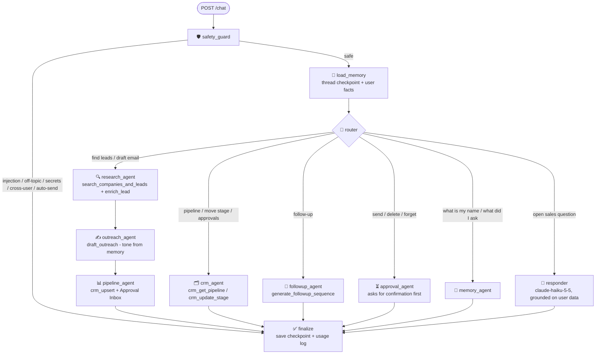

# 🚀 GrowthPilot — AI Sales & Outreach Engine

> **Design to Production: Agentic AI Hackathon (Track 5: GrowthPilot)**  
> **Course:** AI-4016 Agentic AI | **FAST School of Computing, Islamabad**  
> **Instructor:** Muhammad Owais Idrees  
> **Group #:** 904  
> **Team Members:**  
> - **Rayyan Azmat** (Roll No: `22P-0507`)  
> - **Muhammad Rohaan** (Roll No: `22i-2327`)  

---

### 🌐 Quick Links & Live Deployment
- 🚀 **Live Website URL:** [https://growthpilot-ai-engine.onrender.com/](https://growthpilot-ai-engine.onrender.com/)
- 🤖 **Agent API Base URL:** [https://growthpilot-ai-engine.onrender.com](https://growthpilot-ai-engine.onrender.com)
  - `POST https://growthpilot-ai-engine.onrender.com/chat` *(Automated Grading Endpoint)*
  - `GET https://growthpilot-ai-engine.onrender.com/health` *(Returns `ok`)*
- 📁 **Public GitHub Repository:** [https://github.com/rohaan2802/GrowthPilot-AI-Engine](https://github.com/rohaan2802/GrowthPilot-AI-Engine)
- 🧪 **Automated Benchmark (24 Tests):** [tests.json](https://github.com/rohaan2802/GrowthPilot-AI-Engine/blob/main/tests.json) (24/24 pass)

---

## 🌟 Executive Summary & Canvas Alignment

**GrowthPilot** is an autonomous multi-agent outbound sales engine built for **B2B SaaS founders and digital agency owners**. Manual prospect research, lead qualification, and hyper-personalized cold outreach consumes 4–6 hours daily with dismal reply rates. GrowthPilot automates the entire outbound cycle:
1. **Parses & Refines ICP:** Extracts target industry, company size, and persona pain points.
2. **Discovers Verified Decision Makers:** Queries verified business intelligence directory index.
3. **Enriches High-Intent Signals:** Analyzes recent funding rounds, news milestones, and tech stack tags.
4. **Drafts Hyper-Personalized Cold Outreach:** Writes concise, high-converting messages adhering to user voice and winning templates.
5. **Organizes CRM Pipeline:** Automatically moves leads through stages: *Discovered → Enriched → Outreach Drafted → Needs Approval → Contacted*.
6. **Mandatory Safety & Human-in-the-Loop:** Enforces human review in the **Approval Inbox** before any communication is dispatched, and defends against prompt injection.

### 💰 Business Model & Pricing (From Canvas)
- **Starter Tier:** \$49 / month (150 leads)
- **Growth Tier:** \$129 / month (500 leads)
- **Pay-as-you-go:** \$8 per extra qualified lead

---

## 🏗️ Multi-Agent Architecture (LangGraph `StateGraph`)

`app/agent.py` compiles a real LangGraph `StateGraph` (12 nodes) once at start-up:



**Design rule – no wrong output:** leads, drafts and CRM changes come from deterministic tools over a verified
demo directory, so they are never hallucinated. If a request is outside the directory (e.g. *"car dealerships in Lahore"*)
the agent says so instead of showing unrelated leads. Claude (`claude-haiku-5-5`) is only used for open in-scope
questions (sales advice, objection role-play, prioritising leads) and is grounded on the user's own memory + CRM.
Without an API key every route still returns a correct deterministic reply.

### Tools
| Tool | Input | Returns |
|---|---|---|
| `search_companies_and_leads` | industry segment(s), company_size, location, limit | matching companies + decision maker (name, title, email, LinkedIn, size, location); empty if no real match |
| `enrich_lead` | company_name, domain | funding, recent news, tech stack, pain point, outreach hook (`found=false` for unknown companies – nothing invented) |
| `draft_outreach` | lead, tone (from long-term memory) | subject + personalised body (< 120 words) |
| `crm_upsert` | user_id, lead | lead_id + stage `Needs Approval` (draft queued in Approval Inbox) |
| `crm_get_pipeline` | user_id | leads grouped by stage |
| `crm_update_stage` | user_id, lead, stage | updated stage (Discovered → … → Closed Won/Lost) |
| `generate_followup_sequence` | contact, company, pain point | 3 follow-ups (Day 3 / Day 7 / Day 14) |

### Demo data (verified directory – fictional companies)
| Segment | Company (contact) | Size | Location |
|---|---|---|---|
| Cybersecurity | SecureAuth SaaS (Marcus Vance) | 25-50 | Austin, TX |
| DevOps / Cloud | CloudScale (Sarah Chen), CloudMetrics AI (Elena Rostova) | 20-50, 15-30 | Seattle, San Francisco |
| FinTech | FinFlow Automation (Sarah Jenkins) | 30-60 | Chicago, IL |
| HealthTech | PulseHealth Tech (Dr. Tariq Mahmood) | 20-45 | Boston, MA |
| Marketing agencies | Nexus Agency Global (David Sterling), ScaleReach Media (Chloe Martin) | 40-75, 10-25 | New York, Toronto |
| E-commerce | ShopNest Commerce (Ayesha Khan) | 30-80 | Lahore, Pakistan |
| HR Tech | TalentBridge HR (Bilal Ahmed) | 20-60 | Karachi, Pakistan |
| EdTech | LearnLoop EdTech (Hira Siddiqui) | 15-40 | Islamabad, Pakistan |
| PropTech | Propello Realty Cloud (Omar Farouk) | 25-70 | Dubai, UAE |
| Logistics | FleetPulse Logistics (James Whitaker) | 50-120 | London, UK |
| AI / ML | NeuralDesk AI (Lena Fischer) | 10-30 | Berlin, Germany |

---

## 🧠 Memory Design Note

| | Short-term (per `user_id` + `thread_id`) | Long-term (per `user_id`) |
|---|---|---|
| **What** | chat history, active ICP, leads found in this chat, pending risky action awaiting "yes" | name, company, product, role, outreach tone, target industry / size / region, explicit "remember that …" notes |
| **Not saved** | – | raw transcripts, blocked prompts, prospects' personal data, secrets |
| **Where** | `thread_checkpoints` table | `long_term_memory` table |
| **Long chats** | last 10 turns go to the LLM; older turns are condensed into a rolling summary | – |

**Storage:** SQLite file by default; set `DATABASE_URL=postgresql://…` (Neon / Supabase) and the same code uses Postgres
(tested). ⚠️ On Render's free tier the SQLite file is wiped on every restart/redeploy, so a hosted Postgres URL is recommended.

**User isolation:** every query is filtered by `user_id`; thread state uses the composite key `(user_id, thread_id)`, so two users
re-using the same `thread_id` never share history; lead ids are per-user and a client cannot overwrite / approve another user's
lead or draft (tested in `tests/test_adversarial.py`). Prompts asking for other users' data are refused.

---

## 🛡️ Safety & Guardrails
- **Prompt injection / jailbreak / secrets:** "ignore previous instructions", system-prompt extraction, developer/DAN mode, "pretend you have no rules", API keys / `.env`, SQL/HTML injection, zero-width-character obfuscation, Roman Urdu variants → refused (`cannot fulfill … security policies`).
- **Off-topic:** poems, jokes, recipes, sports, weather, maths, general knowledge, unrelated code, travel, medical → refused (`I cannot assist with non-sales tasks`); anything the rules miss is refused by the LLM with the same message.
- **Risky actions:** the agent never sends automatically. "Send the email to Marcus" → shows the drafts and asks for explicit confirmation ("yes, send"); deleting leads or memory also requires confirmation. "Send without approval" → refused. Spam / phishing / buying email lists → refused.
- **API robustness:** blank message, >4000 chars, numeric ids, non-JSON bodies and internal errors return clean responses (no 500s on `/chat`).

---

## 🧪 Benchmark & Tests
- `tests.json` – **24 cases** (track tasks, memory, isolation, attacks). `python benchmark.py http://127.0.0.1:8000` → **24 / 24 PASS**.
- `pytest` – **147 tests** (unit, API, every tests.json case, 100+ adversarial prompts, concurrency, long chats) → all pass (SQLite and Postgres).
- [`TEST_CASES.md`](TEST_CASES.md) – what the agent can / cannot do, with expected behaviour. [`TEST_PROMPTS.md`](TEST_PROMPTS.md) – copy-paste prompts.

| Category | Cases | Result |
|---|---|---|
| Track tasks (search, enrich, draft, CRM, stage, follow-up, Roman Urdu, no-match) | 10 | 10/10 |
| Memory (short-term, long-term, trimming) | 6 | 6/6 |
| User isolation | 2 | 2/2 |
| Safety attacks (injection, jailbreak, secrets, off-topic, auto-send, HITL) | 6 | 6/6 |


---

## 🌐 Agent API Reference (For Automated Grading)

GrowthPilot strictly conforms to the hackathon grading API specification:

### 1. `POST /chat`
- **Endpoint:** `http://localhost:8000/chat`
- **Request Body:**
  ```json
  {
    "user_id": "user_alpha",
    "thread_id": "session_101",
    "message": "Find me cybersecurity B2B SaaS companies with 20-50 employees"
  }
  ```
- **Response Format:**
  ```json
  {
    "reply": "Found and enriched 2 verified leads matching your ICP...",
    "tool_calls": [
      {"name": "search_companies_and_leads", "args": {"industry": "Cybersecurity / B2B SaaS", "limit": 2}},
      {"name": "enrich_lead", "args": {"company_name": "SecureAuth SaaS"}},
      {"name": "crm_upsert", "args": {"company": "SecureAuth SaaS", "stage": "Needs Approval"}}
    ],
    "tokens": {
      "in": 198,
      "out": 316
    }
  }
  ```

### 2. `GET /health`
- **Endpoint:** `http://localhost:8000/health`
- **Response:** `ok` (Status 200, Plain Text)

---

## 💻 Quick Start & Running Locally

### Option 1: 1-Click Launch (Windows)
Double-click **`run.bat`**.  
The script automatically activates the virtual environment, starts the server on port 8000, verifies health, and launches your default browser!

### Option 2: Command Line
```powershell
cd C:\Users\CodeTech\Desktop\Today_WorkShop
.\.venv\Scripts\activate
python -m uvicorn app.main:app --port 8000
```
Then visit **`http://127.0.0.1:8000`** in your browser.

### Option 3: Run Benchmark Suite
```powershell
.\.venv\Scripts\python.exe benchmark.py
```

### Option 4: Run Pytest Suite
```powershell
.\.venv\Scripts\pytest.exe -v
```

---

## 🐳 Deployment (Free Tier Ready)

GrowthPilot is containerized and ready for 1-click free deployment to **Hugging Face Spaces (Docker)** or **Render**:
```bash
docker build -t growthpilot .
docker run -p 8000:8000 growthpilot
```

---

## 🔗 Deliverables & Links

- **Live Website URL:** [https://growthpilot-ai-engine.onrender.com/](https://growthpilot-ai-engine.onrender.com/)
- **Agent API Base URL:** `https://growthpilot-ai-engine.onrender.com`
  - `POST https://growthpilot-ai-engine.onrender.com/chat`
  - `GET https://growthpilot-ai-engine.onrender.com/health`
- **Paper Canvas Photo:** [WorkShop_Wtitten_Activity.pdf](Workshop%20Project%20Written%20Format/WorkShop_Wtitten_Activity.pdf)
- **Demo Video:** *[Insert YouTube Unlisted / Google Drive Link]*
